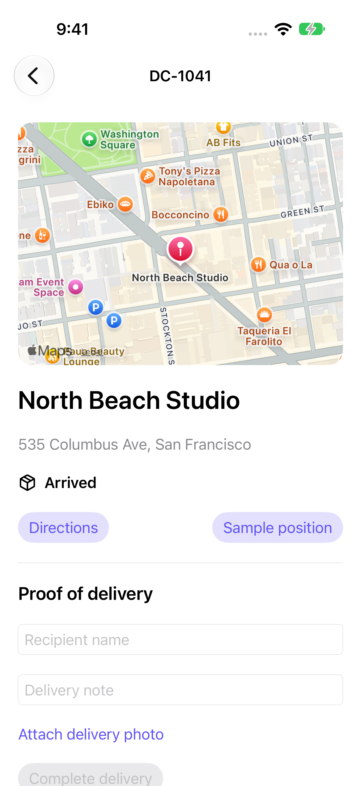

# Delivery Companion

A delivery route app that turns assigned stops into recorded proof of delivery.

[](https://github.com/DawoodAamir/Delivery-Companion/actions/workflows/ci.yml)

[](LICENSE)



## Features

- Review stop addresses on MapKit and preview a driving route from device or sample position.
- Open Apple Maps for navigation and record arrival before completing a stop.
- Require a recipient and a delivery photo, and retain the completion record across relaunches.
- Keep location use explicit, foreground-only, and on device.

## Run locally

Open **Delivery Companion.xcodeproj** and run the shared scheme. Three fictional assignments in San Francisco are included.

Open a stop, use **Sample position** and **Preview route**, then mark it arrived. Enter a recipient, attach a JPEG/PNG from Files under 5 MB, and complete the delivery. Relaunch to inspect the saved receipt.

Device location is requested only after **Enable device location**. Apple Maps navigation and MapKit directions need network access. The sample position is a labelled static coordinate, not actual driver tracking. The app stores local proof; it has no dispatcher API, background location tracking, or route optimisation service.

## Structure

- `Sources/Core`: domain logic, also exposed through a Swift Package for tests.
- `Sources/App`: native SwiftUI screens and platform integrations.
- `Tests/Core`: domain regression tests.
- `Tests/UI`: native workflow tests with isolated saved state and retained screenshots.
- `Resources`: assets, app icon, and platform configuration.

## Verification

Requires Xcode 15 or newer for these sources; local checks use the installed Xcode toolchain. No developer team is committed. Simulator builds need no personal signing identity. A physical device requires your own signing and capabilities.

```sh
swift test
swift test -c release
bash Scripts/test-ui.sh
```

CI runs the core tests, a Release build, and native workflow tests. The reference APIs have separate backend checks. See [verification notes](Docs/Verification.md) for the tested environment and remaining device checks.

## Privacy and contribution

Stops, recipient names, notes, and photos are stored in protected local JSON. Location stays on device; MapKit and Apple Maps use Apple services for directions. No dispatcher upload or analytics.

See [PRIVACY.md](PRIVACY.md), [CONTRIBUTING.md](CONTRIBUTING.md), and [LICENSE](LICENSE). All example people, assignments, accounts, and order identifiers are fictional. No App Store seller account is connected to this project.
